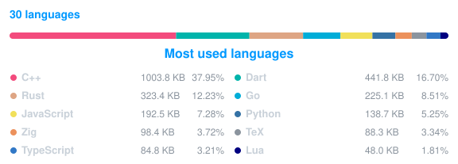

  
  <h3>Greetings to my Shire Folks... </h3>
  

  <a href="https://linkedin.com/in/vinayak-gupta-70a808202" target="_blank">
   <svg xmlns="http://www.w3.org/2000/svg" width="2em" height="2em" viewBox="0 0 24 24">
	<path d="M0 0h24v24H0z" fill="none" />
	<path fill="currentColor" d="M20.447 20.452h-3.554v-5.569c0-1.328-.027-3.037-1.852-3.037c-1.853 0-2.136 1.445-2.136 2.939v5.667H9.351V9h3.414v1.561h.046c.477-.9 1.637-1.85 3.37-1.85c3.601 0 4.267 2.37 4.267 5.455v6.286zM5.337 7.433a2.06 2.06 0 0 1-2.063-2.065a2.064 2.064 0 1 1 2.063 2.065m1.782 13.019H3.555V9h3.564zM22.225 0H1.771C.792 0 0 .774 0 1.729v20.542C0 23.227.792 24 1.771 24h20.451C23.2 24 24 23.227 24 22.271V1.729C24 .774 23.2 0 22.222 0z" />
</svg></a>
  &nbsp;&nbsp;
  
  &nbsp;&nbsp;
  
  &nbsp;&nbsp;
  
  &nbsp;&nbsp;
  

 

## 👨‍💻 About Me

Language-agnostic Systems Software Engineer with ~3 years of experience engineering high-concurrency backends, distributed infrastructure, low-level compilers, and cross-platform applications. Driven by first principles, algorithmic rigor, and computing fundamentals.

- ⚙️ **Systems & Compilers**: Author of custom functional compilers ([VKS-LLVM](https://github.com/vinayakgupta29/llvm-compiler)), serialization engines ([GOD](https://github.com/vinayakgupta29/GOD)), and zero-dependency POSIX network stacks in pure C.
- 🔐 **Distributed Systems & Security**: Architected high-concurrency cryptographic Key Management Services ([Zundrath](https://github.com/vinayakgupta29/zundrath)), ACID embedded ledger engines ([Bahi Khata](https://github.com/vinayakgupta29/personal_bahi_khata)), and zero-trust data stores.
- 🧠 **Applied AI & NLP**: Built local CPU transformer inference pipelines ([FinDecision](https://github.com/vinayakgupta29/FinDecision)) and autonomous agentic workflows.
- 📱 **Cross-Platform & Client**: Production applications in **Flutter** (published on Google Play), Linux desktop tooling, and browser extensions ([Tab Crate](https://github.com/vinayakgupta29/TabCrate)).
- 🚀 **Polyglot & Fast Learner**: Routinely ramps up on new languages, paradigms, and specifications within two weeks.
- 🌏 Exploring Japanese language and culture (JLPT in progress).

  <a href="https://raw.githubusercontent.com/vinayakgupta29/portfolio/main/vinayak_gupta_cv.pdf">📄 <b>Download My CV</b></a> &nbsp;•&nbsp; 
  <a href="https://raw.githubusercontent.com/vinayakgupta29/portfolio/main/vinayak_gupta_resume_AI_centric.pdf">📝 <b>Download My Resume</b></a>

---

## 🚀 Featured Projects

Here are flagship open-source projects highlighting my engineering capabilities across compilers, distributed systems, embedded engines, and applied AI:

### 1. [VKS-LLVM Compiler](https://github.com/vinayakgupta29/llvm-compiler)

> **Statically typed functional systems language with OCaml frontend (Menhir), Rust backend, and native x86-64 code generation via LLVM**

- **Stack**: `OCaml`, `Menhir`, `Rust`, `LLVM IR`, `x86-64`
- Multi-stage compiler pipeline implementing LALR parsing, semantic type checking, algebraic data types, pattern matching, and native LLVM IR code emission.
- Compiles standalone x86-64 executables with zero external runtime dependencies.

### 2. [Personal Bahi Khata](https://github.com/vinayakgupta29/personal_bahi_khata)

> **Offline-first financial ledger featuring an ACID-compliant embedded storage engine in Rust and cross-platform Flutter client**

- **Stack**: `Rust`, `Flutter`, `Dart`, `Applied Cryptography`, `FFI`, `Android`
- Engineered an ACID crash-resilient embedded storage engine in Rust with Write-Ahead Logging (WAL) and authenticated AES-256-GCM zero-knowledge encryption.
- Sub-1ms FFI boundary latency marshaling complex financial ledgers; published on [Google Play Store](https://play.google.com/store/apps/details?id=com.vins.bahi_khata).

### 3. [GOD (Grounded Object Data) Serialization Format](https://github.com/vinayakgupta29/GOD)

> **Lightweight, null-safe data serialization format with native tabular syntax and Go reflection engine**

- **Stack**: `Go`, `EBNF`, `Lexer/Parser`, `Reflection`
- Authored a formal EBNF grammar and deterministic parsing engine guaranteeing zero-null safety across structured data payloads.
- Native tabular syntax cuts serialization payload sizes by up to 50% relative to standard JSON.

### 4. [Zundrath Key Management System (KMS)](https://github.com/vinayakgupta29/zundrath)

> **High-concurrency cryptographic key management service in Go with sub-2ms retrieval latency**

- **Stack**: `Go`, `Echo`, `AES-256`, `PBKDF2`, `HMAC`, `Docker`
- Manages symmetric key lifecycles with automated zero-downtime rotation, envelope encryption, and per-client HMAC-SHA256 authentication.
- Optimized in-memory caching and lock contention to maintain sub-2ms retrieval latency under 500+ concurrent requests.

### 5. [FinDecision](https://github.com/vinayakgupta29/FinDecision)

> **Financial text & news sentiment classification platform with local CPU transformer inference and SSRF defense**

- **Stack**: `Python`, `FastAPI`, `PyTorch (CPU)`, `Transformers (FinBERT)`, `Trafilatura`, `Pytest`
- 100% local CPU inference leveraging FinBERT-MiniLM without GPU dependencies; features sentence-aware window chunking for long financial reports.
- Hardened SSRF-protected web article scraping with DNS pre-resolution, private IP blocking, and streaming size caps.

### 6. [Tab Crate](https://github.com/vinayakgupta29/TabCrate)

> **Local-first, zero-telemetry multi-browser tab manager extension for Firefox, Zen Browser, and Chrome**

- **Stack**: `JavaScript`, `WebExtensions API`, `HTML/CSS`, `Manifest V2/V3`, `Bash`
- Snapshot, export, validate, and restore multi-window browser sessions with clean plain-text formatting.
- Unified codebase cross-compiling to Manifest V2 (background pages) and Manifest V3 (service workers).

### 7. [Tism Games (SFML Arcade Engine)](https://github.com/vinayakgupta29/smashers_sfml)

> **Real-time 2D desktop arcade game collection built in C++ with SFML featuring deterministic tick loops**

- **Stack**: `C++`, `C`, `SFML`, `Linux / POSIX`, `Physics Simulation`
- Engineered a deterministic 60 FPS game loop decoupling rendering from game-state updates with spatial bounding-box collision detection.
- Features custom screen-to-world pixel coordinate transformations, kinematic particle trajectory math, and native Linux POSIX compilation.

---

## 🔩 Toolbox

  <b>Languages</b> 
  &nbsp;
  &nbsp;
  &nbsp;
  &nbsp;
  &nbsp;
  &nbsp;
  &nbsp;
  &nbsp;
  &nbsp;
  &nbsp;
  

  <b>Backend & Databases</b> 

&nbsp;
&nbsp;
&nbsp;

&nbsp;
&nbsp;
&nbsp;
&nbsp;
&nbsp;

  <b>Client, Mobile & Systems</b> 
  &nbsp;
  <!-- &nbsp;
  &nbsp; -->
  

  <b>DevOps, Cloud & Tooling</b> 
  &nbsp;
  &nbsp;
  &nbsp;
  &nbsp;
  

### 🎯 Focus Areas & Technical Interests

- ⚙️ **Compiler Design & Formal Languages**: Parsing theory (LALR), AST transformations, type systems, and LLVM IR emission.
- 🔐 **Applied Cryptography & Privacy**: Envelope encryption, zero-knowledge storage, deterministic tripcodes, and key management.
- 🗄️ **Database Internals & Storage Engines**: Embedded crash-resilient storage, Write-Ahead Logging (WAL), and custom binary serialization.
- 🌐 **Distributed Systems & High Concurrency**: Sub-millisecond latency tuning, lock contention mitigation, and edge workers.
- 🧠 **Applied AI & Machine Learning**: CPU-optimized transformer inference, length-weighted aggregation, and agentic workflows.

---

## 📈 GitHub Stats

  
  

  

GitHub also displays the native contribution calendar directly on my profile, below this README.

---

## 🙋‍♂️ Connect with me

  
  &nbsp;&nbsp;
  <a href="https://linkedin.com/in/vinayak-gupta-70a808202" target="_blank">
  <svg xmlns="http://www.w3.org/2000/svg" width="2em" height="2em" viewBox="0 0 24 24">
	<path d="M0 0h24v24H0z" fill="none" />
	<path fill="currentColor" d="M20.447 20.452h-3.554v-5.569c0-1.328-.027-3.037-1.852-3.037c-1.853 0-2.136 1.445-2.136 2.939v5.667H9.351V9h3.414v1.561h.046c.477-.9 1.637-1.85 3.37-1.85c3.601 0 4.267 2.37 4.267 5.455v6.286zM5.337 7.433a2.06 2.06 0 0 1-2.063-2.065a2.064 2.064 0 1 1 2.063 2.065m1.782 13.019H3.555V9h3.564zM22.225 0H1.771C.792 0 0 .774 0 1.729v20.542C0 23.227.792 24 1.771 24h20.451C23.2 24 24 23.227 24 22.271V1.729C24 .774 23.2 0 22.222 0z" />
</svg>
</a>
  &nbsp;&nbsp;
  
  &nbsp;&nbsp;
  
  &nbsp;&nbsp;
  

